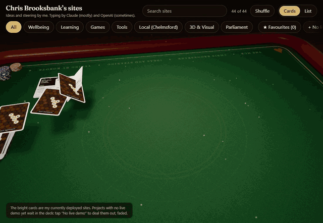

<div align="center">

# Hub · Pick a card. Find a rabbit hole.

**Chris Brooksbank’s corner of the web, dealt onto a 3D table.**

[](https://github.com/ChrisBrooksbank/hub/actions/workflows/ci.yml)


[**Pull up a chair →**](https://chrisbrooksbank-hub.netlify.app/) · [Take the list view](https://chrisbrooksbank-hub.netlify.app/?view=list) · [Report a bug](https://github.com/ChrisBrooksbank/hub/issues)



_An actual browser recording. A small table with a surprisingly large number of exits._

</div>

## The cover story

Every side project starts innocently. A game here. A useful little tool there. A visual experiment that was definitely only going to take an evening. Eventually, you need a website to find your websites.

Hub turns that collection into a deck of cards. Deployed projects take their place on the table; projects without a live demo wait in the deck until you invite them out. Pick a card, inspect the project, and head off to play, learn, make something, or disappear into another experiment.

The editorial policy is simple: **make browsing the work feel like part of the fun.**

> “Ideas and steering by me. Typing by Claude (mostly) and OpenAI (sometimes).”
>
> — Chris, explaining the production department

## Inside this issue

| The attraction                  | What you get                                                                                                                                   |
| ------------------------------- | ---------------------------------------------------------------------------------------------------------------------------------------------- |
| **A proper entrance**           | Cards deal onto a three.js table, with a moving camera and a Shuffle button for another hand.                                                  |
| **Tiny trailers**               | Screenshots give each site a face; cards with a clip play a short preview when selected. Procedural art fills the gaps.                        |
| **Follow your curiosity**       | Search names, descriptions and tags, or filter by category: Games, Learning, Wellbeing, Tools, 3D & Visual, Parliament and Local (Chelmsford). |
| **Keep the good ones**          | Star favourites and filter down to your personal shortlist.                                                                                    |
| **Read the small print**        | Project details include category, language, last update, tags, live links and public source links.                                             |
| **A pocket-sized deck**         | Small screens get hands of 12 cards and a “Deal more” button.                                                                                  |
| **The quiet reading room**      | A semantic list view shares the search and filters. It also takes over automatically when WebGL is unavailable.                                |
| **A place on your home screen** | Install support in compatible browsers, plus an update prompt when a new service worker is ready.                                              |

### Your first minute at the table

1. **Browse the spread.** Pick a card to open its details, then follow its Launch link.
2. **Find your section.** Try a category or type into search. Use **Shuffle** for a fresh arrangement.
3. **Save a discovery.** Add a favourite from its details and use the Favourites filter later.
4. **Look behind the curtain.** Toggle **No live demo** to include projects still waiting for a public home.
5. **Settle in with the list.** Switch to **List** for straightforward links and descriptions. Your view choice is remembered when browser storage is available.

Prefer a still image? [See the card table](docs/media/hub-table.png) or [the list view](docs/media/hub-list.png). The app respects `prefers-reduced-motion`; this README’s GIF is a separate recording.

## Run your own edition

Use **Node.js 22.18+** (or a newer supported release) and npm. The data scripts run TypeScript directly with Node; CI and Netlify use Node 22.

```bash
git clone https://github.com/ChrisBrooksbank/hub.git
cd hub
npm ci
npm run dev
```

Open the local URL printed by Vite. The checked-in manifest and media are enough to get started; scanning accounts and regenerating previews are optional maintenance jobs.

| Command               | Purpose                                                    |
| --------------------- | ---------------------------------------------------------- |
| `npm run dev`         | Start the development server.                              |
| `npm run build`       | Type-check and build the static site into `dist/`.         |
| `npm run preview`     | Serve the production build locally.                        |
| `npm run check`       | Run type-checking, ESLint, Prettier checks and unit tests. |
| `npm test`            | Run Vitest in watch mode.                                  |
| `npm run test:e2e`    | Run Playwright browser tests.                              |
| `npm run perf:budget` | Check the JavaScript bundle budget after building.         |
| `npm run knip`        | Find unused files, exports and dependencies.               |

For browser tests, install Chromium once with `npx playwright install chromium`.

## How a project becomes a card

The collection has two sources, merged by site `id`:

- [`data/sites.generated.json`](data/sites.generated.json) is produced by the scanner. Treat it as generated output.
- [`data/sites.overrides.json`](data/sites.overrides.json) is the editor’s desk. Handwritten values win, and new entries can add sites without a repository.

To add a standalone site, append a complete entry to the overrides array:

```json
{
  "id": "my-next-idea",
  "name": "My Next Idea",
  "url": "https://example.com",
  "description": "The thing that was definitely only going to take an evening.",
  "category": "Tools",
  "tags": ["experiment"],
  "language": "TypeScript",
  "isPrivateRepo": false,
  "lastPushed": null
}
```

For an existing site, a small override such as `{ "id": "my-next-idea", "hidden": true }` is enough. The scanner marks private-repository sites hidden automatically; an explicit override can change that decision.

**Hidden means excluded from the build.** The Vite plugin removes hidden entries before bundling and removes their thumbnails and clips from `dist/`. The source manifests still live in this repository, so keep secrets out of them.

### Refresh the shelves

```bash
npm run sites:scan     # Discover repos and deployed URLs; rebuild the generated manifest
npm run sites:shots    # Capture site screenshots into public/thumbs/
npm run sites:clips   # Convert repository README GIFs into public/clips/ MP4 previews
```

The scanner uses authenticated **GitHub CLI (`gh`)**, local repositories under `C:\code` by default, and optional Netlify lookups through `NETLIFY_AUTH_TOKEN`. Set `HUB_CODE_DIR` to scan a different local directory. Keep credentials in your environment.

Screenshots need Playwright Chromium; clips need `gh` and **ffmpeg**. Target a single project with `npm run sites:shots -- --only <id>` or `npm run sites:clips -- --only <id>`. Both support `--force` for a refresh.

README GIF links can use an absolute `raw.githubusercontent.com` URL into the same repository. Clips default to a 12-second cap; pass `--seconds <n>` for a longer clip, or `--poster <id>@<seconds>` to set a thumbnail from a particular frame.

## Under the table

**Vite + strict TypeScript + vanilla three.js**, with Zod validating the manifest. DOM controls handle search, filters and project details; three.js supplies the card table. The 3D code loads through a dynamic import, so the list route can start without loading it.

```text
src/table/       Card art, layout, dealing choreography and interactions
src/ui/          Shared toolbar, list, favourites and detail panel
src/engine/      Rendering infrastructure and procedural artwork
src/data/        Schema, manifest loading and override merging
scripts/         Discovery, screenshots, clips and build plugins
data/            Generated catalogue + handwritten overrides
public/          Thumbnails, clips, icons and PWA assets
specs/           Project specifications
e2e/            Playwright browser checks
```

Accessibility is part of the furniture: a non-3D route, reduced-motion handling, labelled controls, result announcements, and a detail dialog that traps focus and restores it on close. Vitest covers the logic; Playwright exercises browser flows, with axe checks for accessibility.

See the [specifications](specs/) and [implementation plan](IMPLEMENTATION_PLAN.md) for the project’s working notes and history. The current source is the reference for what ships today.

## Send it to the web

Connect the repository to Netlify. [`netlify.toml`](netlify.toml) supplies the build command (`npm run build`), publish directory (`dist/`), routing and response headers. No application server is required.

[CI](.github/workflows/ci.yml) runs the checks, production build and Playwright tests on pushes and pull requests targeting `main`. A Husky pre-commit hook runs ESLint and Prettier on relevant staged files.

Found a rough edge, or have an idea for the table? [Open an issue](https://github.com/ChrisBrooksbank/hub/issues) with what happened, what you expected, and your browser or device. For a code change, run `npm run check` before opening a pull request; add browser checks when changing an interaction.

---

**Made by Chris Brooksbank, with Claude and OpenAI on typing duty.** A directory for the projects, and a little project in its own right. [Pick your next card →](https://chrisbrooksbank-hub.netlify.app/)
